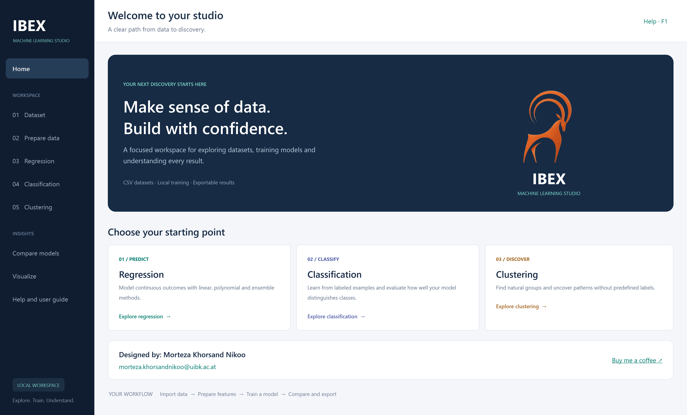

# IBEX Machine Learning Studio

A Windows desktop workspace for exploring datasets, preparing features, training machine learning models and inspecting results. Built with C#, WPF and .NET 8.

Designed by **Morteza Khorsand Nikoo** · [morteza.khorsandnikoo@uibk.ac.at](mailto:morteza.khorsandnikoo@uibk.ac.at)

**Open-source software under GNU GPL version 3 or later (GPL-3.0-or-later). Academic and commercial use are permitted under the license.**



## Features

- CSV import, dataset summaries and correlation matrices.
- Data preparation, feature transformations and PCA.
- 11 regression, 9 classification and 4 clustering algorithms.
- Training/test evaluation and K-fold results, including metrics for individual folds.
- Predictions entered using original feature names when PCA is used internally.
- Interactive visualizations, chart and table exports, and page-specific reset controls.
- Searchable offline help and an illustrated, printable machine learning cheat sheet.

## Use the app

For end users, download `IBEX.MLStudio.exe` from this repository's **Releases** section once a release has been uploaded. A release built with the included single-file publishing script bundles .NET and native dependencies, so users do not need to install .NET separately. The runtime extracts bundled files into a local cache on first launch.

Source-code ZIP downloads are for developers; they do not contain a prebuilt executable.

Open **Dataset → Import dataset** to choose a CSV. The `Samples/curve.csv` file provides a small example. The app's **Help and user guide** button and F1 explain the current page.

## Build from source

Use Windows x64, the **.NET 8 SDK**, and optionally Visual Studio 2022 with the **.NET desktop development** workload. The SDK is needed for development; the packaged release does not require it.

From the repository folder:

```powershell
dotnet restore MLStudio.csproj
dotnet build MLStudio.csproj -c Release
dotnet run --project MLStudio.csproj -c Release --no-build
```

You can also open `MLStudio.csproj` directly in Visual Studio. The standalone project does not require a Microsoft Store packaging project or publisher account.

## Publish one self-contained EXE

Install Visual Studio's C++ build tools so the MSVC x64 CRT and OpenMP redistributable files are available, then run:

```powershell
./Publish-SingleFile.ps1
```

Output: `release-single/IBEX.MLStudio.exe`. The script restores dependencies, bundles the runtime, native libraries, samples, guide and cheat sheet, and checks that the publish output contains exactly one executable. If an older EXE exists, it preserves a backup under `obj/single-file/` before replacing it.

If automatic MSVC detection cannot find your installation, pass `-VCRedistPath` pointing to its `VC/Redist/MSVC/<version>/x64` folder. Use `-OutputDirectory` to select a different destination. Upload the resulting EXE as a GitHub **Release asset**, rather than committing it to source control.

## Verify

Run the WPF checks on a Windows desktop session:

```powershell
dotnet run --project Tests/Smoke.csproj -- Tests/verification
$env:IBEX_HELP_TEST = '1'
dotnet run --project Tests/Smoke.csproj -- Tests/help-verification
Remove-Item Env:IBEX_HELP_TEST
```

Tests exercise navigation, model fitting, PCA prediction inputs, page reset, exports, help and rendering. They create screenshots and logs in ignored output folders.

To check a published executable with isolated .NET settings:

```powershell
./Tests/Verify-SingleFile.ps1 -Executable ./release-single/IBEX.MLStudio.exe -VerificationDirectory ./Tests/release-verification
```

Some currently resolved transitive .NET 11 preview dependencies emit compatibility warnings against .NET 8. The repository preserves the application's existing dependency versions; review these warnings when changing packages.

## Documentation

- [Complete user guide (PDF)](docs/pdf/IBEX_Machine_Learning_Studio_User_Guide.pdf)
- [Illustrated cheat sheet (PDF)](docs/pdf/IBEX_Machine_Learning_Cheat_Sheet.pdf)
- [Maintaining the documentation](docs/AUTHORING.md)
- [Contributing](CONTRIBUTING.md)
- [Third-party dependencies](THIRD_PARTY_NOTICES.md)

## Project layout

| Folder | Contents |
| --- | --- |
| `Views/` | Desktop pages and user interactions |
| `ML/` | Data processing and machine learning code |
| `Helpers/` | Shared utilities |
| `Themes/`, `Assets/` | WPF styles and app assets |
| `Help/` | Embedded searchable guide, illustrations and cheat sheet |
| `Samples/` | Example CSV |
| `Tests/` | Verification harness and single-file checks |
| `docs/` | Printable documentation and authoring scripts |

## License

Copyright (c) 2026 Morteza Khorsand Nikoo.

IBEX Machine Learning Studio is free software: you may redistribute and/or modify it under the GNU General Public License as published by the Free Software Foundation, either version 3 or, at your option, any later version. See [LICENSE](LICENSE) for the full terms and [NOTICE](NOTICE) for the project's licensing declaration.

Academic and commercial use are allowed. Distribution of GPL-covered software, including modified versions, must comply with GPL requirements, including providing corresponding source as required by the license. Using the app internally does not by itself require publishing your datasets or analysis. The software comes without warranty. Third-party dependencies retain their own licenses.

## Support

Questions and bug reports are welcome through GitHub Issues. Please include reproduction steps and a small synthetic dataset, without personal or confidential data.

If you find IBEX useful, you can [support its development on Ko-fi](https://ko-fi.com/mortezakhorsand).
